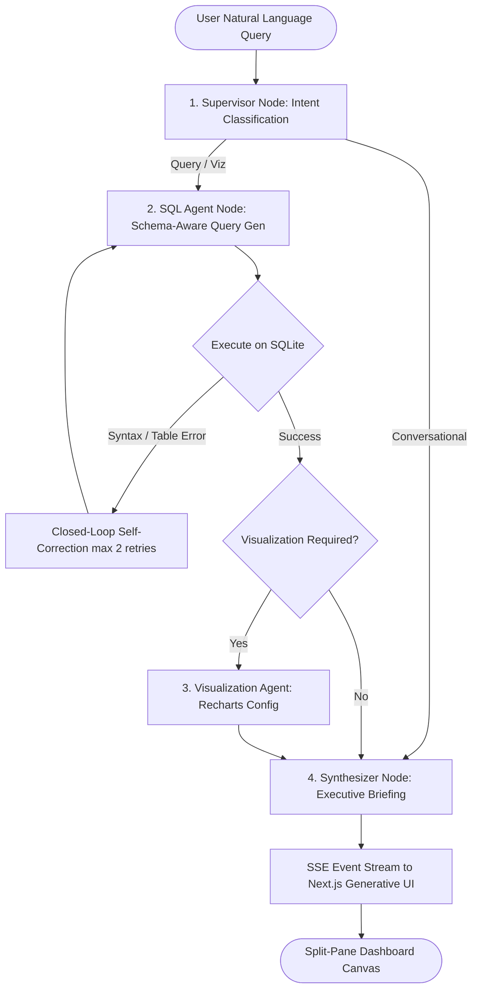

# Conversational AI Data Analyst (Text-to-SQL)

> An autonomous multi-agent business intelligence system that translates natural language into verified SQLite queries and interactive visualizations, eliminating ad-hoc reporting bottlenecks for engineering and analytics teams.

[](https://nextjs.org/)
[](https://langchain-ai.github.io/langgraph/)
[](https://ai.google.dev/)
[](https://sqlite.org/)
[](https://www.typescriptlang.org/)
[](https://tailwindcss.com/)

---

## 💡 Overview & Problem Statement

Traditional business intelligence workflows suffer from persistent friction: business stakeholders submit ad-hoc data requests, product questions stall in ticket backlogs, and data engineers spend valuable sprint cycles hand-authoring repetitive SQL queries.

**InsightPulse AI Data Analyst** solves this by orchestrating a cyclical, multi-agent state machine that:
1. Translates ambiguous natural language into syntactically valid SQLite queries.
2. Validates and executes queries against the **Chinook Music Store** database in a sandboxed, read-only environment.
3. Automatically self-heals syntax or schema errors via a closed-loop feedback retry cycle.
4. Synthesizes query results into dynamic, production-grade Recharts visualizations and executive business insights.

---

## 🛠️ Tech Stack

*   **Next.js 14+ (App Router)**: Full-stack React framework utilizing Server-Sent Events (SSE) streaming for real-time agent token and state updates.
*   **LangGraph (LangChain)**: Cyclical multi-agent orchestration framework powering specialized supervisor, SQL generation, self-correction, visualization, and synthesis nodes.
*   **Vercel AI SDK**: Client-side reactive stream processing and Generative UI state management.
*   **Google Gemini 3.8 Flash (`gemini-3.8-flash`)**: High-throughput frontier LLM for intent extraction, SQL synthesis, and executive briefing.
*   **SQLite (Chinook Database)**: Relational local database (11 normalized tables, 2,000+ records) managed via native SQLite drivers (`better-sqlite3` and Python `sqlite3`).
*   **Recharts**: Declarative composable charting library rendering dynamic Bar, Line, Area, and Pie visualizations from agent-generated JSON specifications.
*   **Tailwind CSS & Lucide Icons**: Responsive split-pane dashboard canvas with dark-mode optimized glassmorphism styling.

---

## 🧠 System Architecture & Multi-Agent Flow

The system employs a cyclical directed graph built on LangGraph state channels:



### Agent Nodes Breakdown
*   **Supervisor Agent**: Classifies user queries into `query_and_viz`, `query_only`, or `conversational`.
*   **SQL Generation Agent**: Inspects database schemas (`Artist`, `Album`, `Invoice`, `Customer`, etc.) and enforces read-only access (destructive commands like `DROP`, `DELETE`, `UPDATE` are strictly rejected).
*   **Self-Correction Engine**: When an SQLite syntax or constraint error occurs, the error trace and offending SQL query are fed back into the agent context for up to 2 automated correction attempts.
*   **Visualization Agent**: Dynamically extracts numerical and categorical axes to emit typed Recharts specs.
*   **Executive Synthesizer**: Produces high-level business commentary, metric summaries, and action recommendations.

---

## 🚀 How to Run Locally

### 1. Prerequisites
*   **Node.js**: v18.0.0 or higher
*   **npm**: v9.0.0 or higher
*   **Google Gemini API Key**: Obtain a free API key from [Google AI Studio](https://aistudio.google.com/app/apikey)

### 2. Clone and Install Dependencies
```bash
# Clone the repository
git clone <YOUR_GITHUB_REPO_URL>
cd text-to-sql-agent

# Install frontend and LangGraph dependencies
npm install
```

### 3. Configure Environment Variables
Create a `.env.local` file in the root directory:
```bash
cp .env.example .env.local
```
Add your Gemini API key to `.env.local`:
```env
GOOGLE_API_KEY=your_gemini_api_key_here
```
*(Note: You can also enter or update your API key directly in the dashboard UI via the Settings modal).*

### 4. Seed the SQLite Database
Seed the Chinook relational database (creates `chinook.db` with 11 tables and sample data):
```bash
npm run setup:db
```

### 5. Launch the Development Server
```bash
npm run dev
```

Open [http://localhost:3000](http://localhost:3000) in your browser.

---

## 🧪 Example Queries to Try

*   *"Top 5 best-selling artists by total revenue with a bar chart"*
*   *"Monthly sales trends across 2022 to 2025 in a line chart"*
*   *"Revenue breakdown by music genre"*
*   *"Who are the top 10 customers by total spend and what countries are they from?"*
*   *"Most popular media types by number of tracks"*

---

## 📁 Repository Structure

```
text-to-sql-agent/
├── app/
│   ├── api/chat/route.ts      # Server-Sent Events (SSE) LangGraph streaming API route
│   ├── api/db/stats/route.ts  # Database connection stats & schema inspection API
│   ├── globals.css            # Tailwind custom styles & scrollbar utilities
│   ├── layout.tsx             # Root dashboard layout
│   └── page.tsx               # Main split-pane application shell
├── backend/                   # Python FastAPI LangGraph backend (optional dual-runner)
│   ├── agent/                 # Python LangGraph state graph, prompts & schemas
│   ├── db/                    # Python SQLite query executor & safety checks
│   └── main.py                # FastAPI SSE streaming service
├── components/
│   ├── agent-steps.tsx        # Live progress indicator for multi-agent reasoning steps
│   ├── chat-interface.tsx     # Conversational chat input with starter prompts
│   ├── dashboard-canvas.tsx   # Pinned visual analytics canvas with KPI cards
│   ├── data-table.tsx         # Interactive data grid with search, pagination & CSV export
│   ├── dynamic-chart.tsx      # Composable Recharts renderer (Bar, Line, Area, Pie)
│   ├── settings-modal.tsx     # Key configuration & schema explorer
│   └── sql-inspector.tsx      # Syntax-highlighted SQL viewer with timing metrics
├── lib/
│   ├── agents/                # TypeScript LangGraph implementation & prompts
│   └── db/                    # Local Chinook SQLite driver & schema extractor
├── scripts/
│   └── setup-chinook.ts       # Database bootstrap and seeder script
├── .gitignore                 # Excludes databases, environments, and builds
├── package.json
└── README.md
```

---

## 🛡️ Security & Sandboxing

*   **Read-Only SQL Sandbox**: Queries are inspected and parsed to guarantee no mutations (`UPDATE`, `DELETE`, `DROP`, `ALTER`, `TRUNCATE` are blocked).
*   **Local Data Boundary**: The Chinook database is hosted locally in SQLite; zero sensitive row data is stored externally.
*   **Zero-Leaked Keys**: API keys are passed securely per-session or managed via local environment files.

---

## 📄 License

Distributed under the MIT License. See `LICENSE` for more information.
